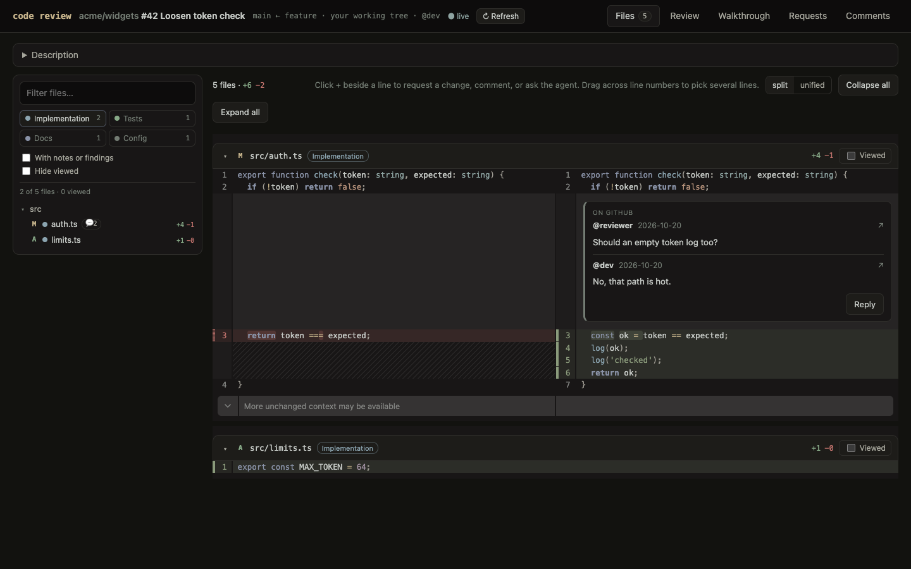
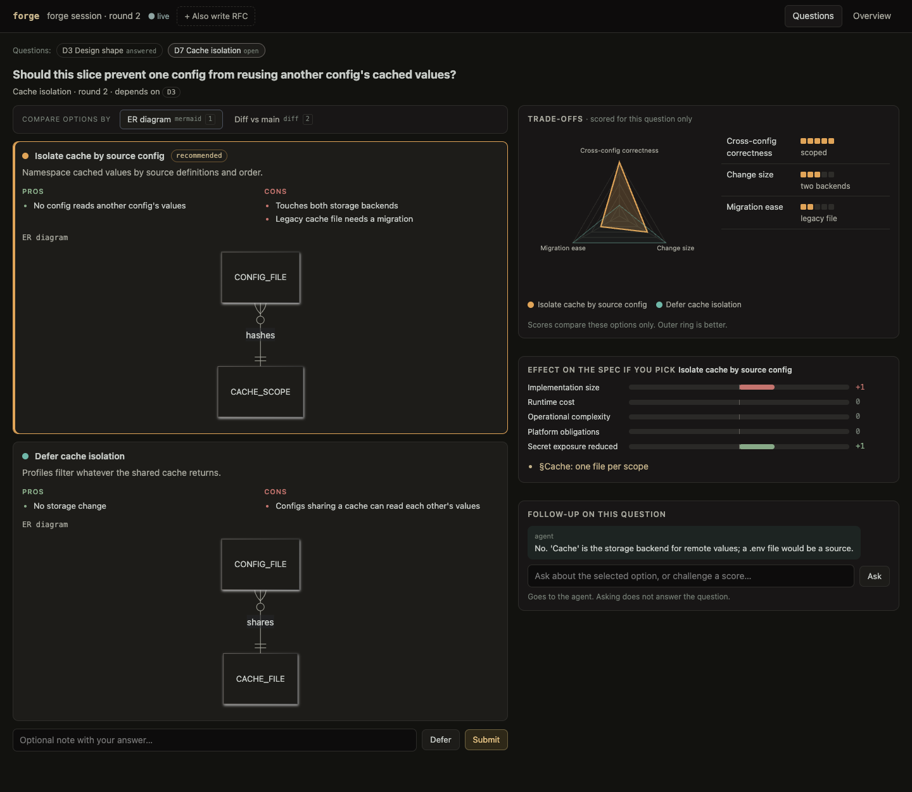
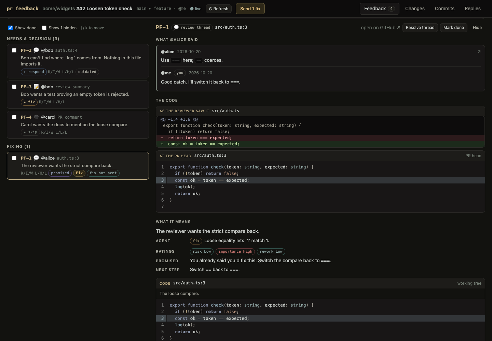

# pi-surface

Browser-based design sessions, code review, and PR feedback for [Pi](https://pi.dev).
The agent works in your checkout. You compare options, read diffs, ask questions,
and send change requests from a local web page. Page actions start a turn in Pi;
the agent sends its answers back to the page.

## Install from GitHub

You need:

- Pi with a configured model. This extension is tested with Pi 1.2.0.
- Node.js 22.19 or newer and npm. Node.js 24 is recommended.
- Git and a browser. For GitHub PRs, install the [GitHub CLI](https://cli.github.com/)
  and run `gh auth login`. Local reviews and design sessions do not need `gh`.

Install the extension and its three skills:

```sh
pi install git:github.com/napisani/pi-surface
```

Pi clones the repo and installs its dependencies. The package's `prepare` script
builds the browser pages. There is no npm package to install and no separate web
server to start.

Restart Pi, or run `/reload` in an existing session. Then start a workflow from
the project you want the agent to work on:

```text
/skill:surface-code-review Review my uncommitted changes against HEAD.
```

The agent opens the review page. If the browser does not open, copy the local URL
shown below Pi's editor. Keep Pi running while you use the page.

To install for one project instead of your user account, run this in that project
and approve Pi's project trust prompt when asked:

```sh
pi install --local git:github.com/napisani/pi-surface
```

Update or remove a GitHub install with:

```sh
pi update git:github.com/napisani/pi-surface
pi remove git:github.com/napisani/pi-surface
```

Run `/reload` after an update. You can pin an install to a commit by appending
`@<commit-sha>` to the Git source. A pinned install stays at that commit.

## Use the workflows

The bundled skills are explicit commands. Invoke one with `/skill:name`; they do
not run automatically based on your prompt.

### Review code

```text
/skill:surface-code-review Review this branch against main.
```

Browse split or unified diffs, filter the file tree, and select lines to ask a
question or request a change. Send change requests in batches; the agent edits
your checkout and reports the result on the page. You can also request a review
with findings or a guided walkthrough. Each finding comes triaged (fix now, fix
now while expanding scope, defer, or skip) and scored on a radar covering the
issue and its fix. Findings whose fix you requested show whether it is queued,
in progress, or applied.

For a GitHub PR, give the skill a PR URL or number. Your own PR can use a live
checkout for edits. Reviews of someone else's PR use a worktree pinned to the
PR head. The agent drafts GitHub comments; you choose when to post them.



### Design a change

```text
/skill:surface-forge-solution Design a per-project cache for this CLI.
```

Compare options with pros, cons, scored trade-offs, and diagrams or code diffs.
Ask follow-up questions before deciding. The overview tracks decisions and shows
a draft technical spec. Request an RFC if you need a separate design document
for reviewers.

Forge is design-only. The agent writes final drafts under `.scratch/` and asks
you to approve them on the page. It does not implement the design.



### Work through PR feedback

```text
/skill:surface-pr-feedback Work through the review comments on my branch's PR.
```

Read each comment beside its code and the agent's analysis. Choose fix, respond,
or skip, then send fixes as a batch. Review the resulting diff, request commit
proposals, and use the page's Commit and Push buttons when ready. Reply drafts
stay on the page until you post them.

You can also paste feedback into Pi chat without a GitHub PR.



These screenshots use the included demo fixtures, not a private repository or a
live GitHub PR.

## Sessions and local access

Use `/surface` to reopen the session's pages, or `/surface forge`,
`/surface review`, and `/surface feedback` to open one workflow.
`/surface stop` shuts down the page server and keeps the session's state; the
next `/surface` starts a new server at a new URL.
`/surface open` opens or reopens the workflow you used last (`/surface open
review` picks one), starting the server again if it was stopped.

Pages open in your default browser (`open` on macOS, `xdg-open` elsewhere). To
use another program, set `surface.browser` in Pi's `settings.json`, globally or
per project. `{url}` in `args` becomes the page URL; without it the URL is
appended. The command runs directly, not through a shell. For example, to open
pages with `terminal-browser` in a new window of the current tmux session:

```json
{
  "surface": {
    "browser": {
      "command": "tmux",
      "args": ["new-window", "-n", "surface", "terminal-browser", "open", "{url}"]
    }
  }
}
```

Every page open uses this setting: the one an opening tool triggers,
`/surface`, and `/surface open`.

Workflow state lives in Pi's session log. Resuming a session restores its page
state. Diffs and file contents come from the checkout, so keep that checkout
available. The server gets a new URL when the session restarts; use the current
URL in Pi rather than an old bookmark.

The server binds to `127.0.0.1` and checks a per-session URL token, the request
host, and the origin of page actions. Treat the URL as private. pi-surface does
not host your code on an external service. The agent still uses your configured
Pi model, and GitHub actions use your `gh` credentials.

The page requires your click to post GitHub comments or replies, resolve threads,
commit, or push. This controls the page's actions, not the agent's other shell or
editing tools.

Browser auto-open supports macOS and Linux. On another platform, open the URL
manually. The browser must be able to reach the machine running Pi's loopback
server.

## Use a local clone

If you want to inspect or edit the extension before installing it:

```sh
git clone https://github.com/napisani/pi-surface.git
cd pi-surface
npm ci
pi install "$PWD"
```

`npm ci` also builds the browser pages. Pi loads a local install from that
checkout without copying it. After pulling updates, run `npm ci` there again,
then `/reload` in Pi. After editing browser code, run `npm run build` and refresh
the page.

For a single Pi invocation without saving an install:

```sh
pi -e /absolute/path/to/pi-surface
```

Run Pi from the project you want to work on, not from the extension's checkout.

## Development

```sh
npm ci
npm run check
npm run lint
```

`check` runs TypeScript checks, bundles the pages, and runs the host, workflow,
and component tests. Tests use temporary Git repositories and a fake `gh`.
They do not call a model or GitHub.

Preview a page with demo data and scripted agent replies:

```sh
node scripts/dev-server.ts
DEV_WORKFLOW=forge node scripts/dev-server.ts
DEV_WORKFLOW=feedback node scripts/dev-server.ts
```

Each command prints a local URL. The default page is a local code review;
`DEV_WORKFLOW=review DEV_MODE=pr-live node scripts/dev-server.ts` shows the PR
review used in the screenshot. Stop each server with Ctrl-C.

Development happens in [napisani/monorepo](https://github.com/napisani/monorepo)
under `pub/pi-surface/`. CI mirrors that directory to this repository after the
pi-surface checks pass.
